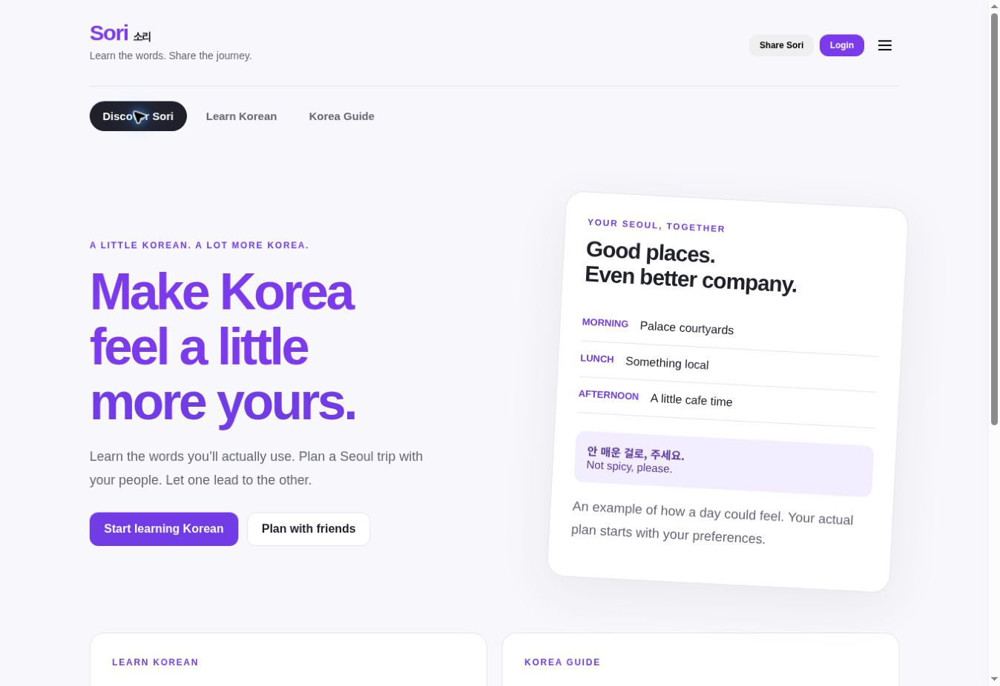
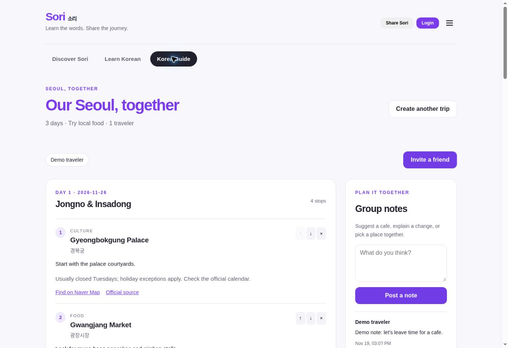
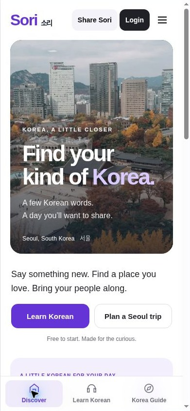
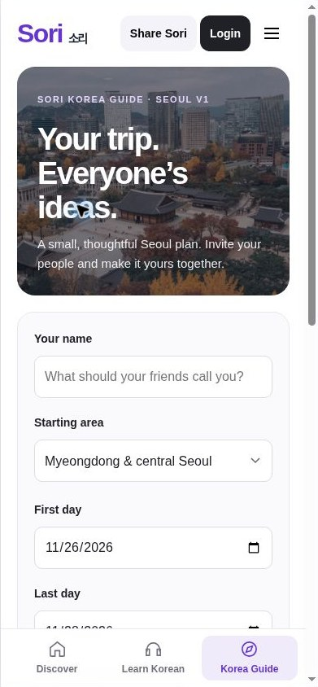
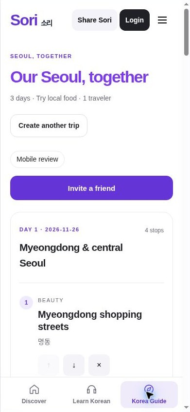

# Sori V1: learning + collaborative Seoul guide

The travel product is a web service. There is no PDF export, print flow or downloadable guide feature. Public service sharing brings new visitors to Sori; private invitations add actual guest members to a shared trip after they accept.

## Implemented

- Two service entry points, Learn Korean and Korea Guide, with a new home screen.
- Existing 358 Korean expressions, category search, audio and quiz; four guide phrases open the corresponding real lesson.
- English Seoul itineraries for 1–3 days, using a small sourced catalog and deterministic preference/area rules. This is not an AI/API itinerary generator, live reservation feed, calculated transit route or nationwide coverage.
- Stateful server trips, single-use seven-day invitation links, up to eight active members, shared stop addition/removal/reordering, group notes and creator-controlled guest removal and unused-invitation cancellation.
- Version checks reject stale itinerary writes. The browser polls for other participants' updates every seven seconds outside active text entry.
- Invitations are deliberately separate from public Share Sori links. Never put a private editing invitation in a public social post.
- Guest memberships are browser-scoped bearer capabilities, not verified personal accounts. Names are display names. Creator/guest secrets are random and only hashes are stored server-side. Lost browser credentials currently require a fresh invitation; creator recovery is not implemented.

## Development persistence and production boundary

`npm run dev` now starts a Node.js 24 server and a development SQLite database (`.sori-dev.sqlite`, ignored by Git). Shared trips are stored on this server, not just in browser state; two clients can read and edit the same trip. They are not saved to the production Firestore or Supabase database. The development workspace is not a production hosting or backup service.

Existing GitHub Pages/static hosting cannot run `/api/trips`. A static-only deployment will keep the landing/learning pages but cannot create shared trips; the UI reports this rather than pretending invites worked. Production release requires a durable shared server/database, HTTPS, service URL setup, backup/restore, operational rate limits, abuse controls and guest/verified-account policy review. The preferred production datastore can be Supabase once the target project is connected; the collaboration persistence adapter still needs porting and live verification. Existing Supabase saved-phrase adapter is separate from this trip backend.

## Verified and pending

Offline tests cover generator validation, Tuesday palace exclusion, actual lesson references, owner/guest permissions, one-time/expired invites, participant cap, cross-participant notes/edits, member revocation and stale-write conflicts. Browser checks cover the landing, form, trip creation, group-note save and guide-to-learning navigation. Live Google login/TTS, isolated real-device collaboration, real phone hardware behavior and production Supabase have not been fully verified.

The mobile-first redesign adds a photo-led home, a fixed Discover/Learn/Guide bottom navigation, safe-area spacing, large touch targets and single-column trip forms/itineraries. Browser-frame checks at 360, 390, 430 and 768 CSS pixels found no horizontal overflow on the home and shared trip. A 390-pixel frame also verified trip creation and the home expression opening its actual Korean lesson. These checks do not emulate iOS/Android hardware or prove native sharing, mobile Google login, keyboard layout or audio playback. The developer-only `/debug/mobile.html` page provides repeatable frame sizes; it is not the customer-facing service. See `photo-credits.md` for downloaded image sources and licensing.

Place descriptions are brief original summaries; `data/places.json` stores exact primary-source links and the checked date. Opening hours/availability/prices are not asserted live. Palace holiday exceptions and dietary restrictions require confirmation. Some catalog entries are district suggestions, not specific restaurant recommendations. Catalog maintenance, broader routing, verified dietary venues, event feeds and localization remain future work.

## Review screenshots

## Mobile-first review

